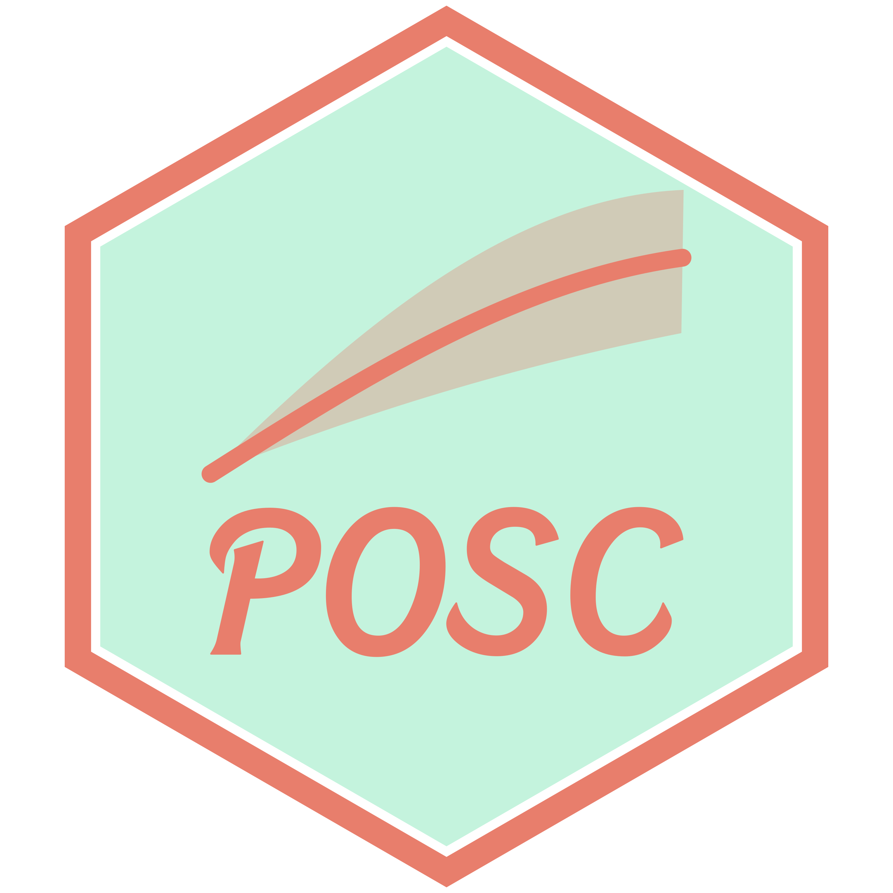
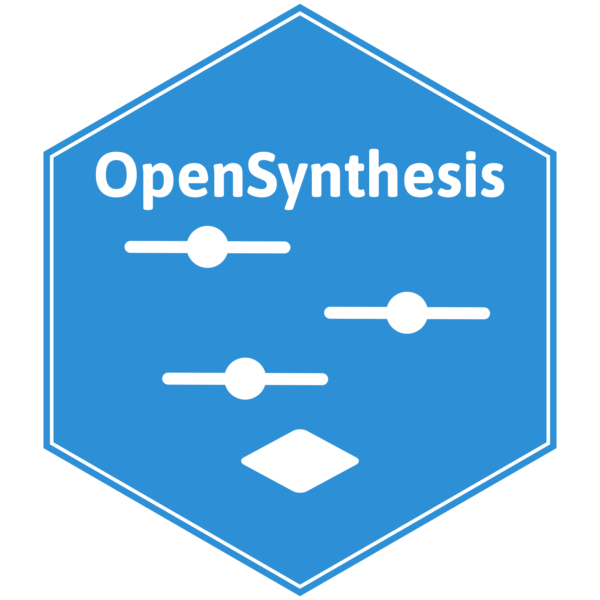

<!--
  Homepage, styled in styles.css under "HOMEPAGE".
  1. Hero: the MJ logo over its animated Poisson histogram, beside the lede.
  2. Tools: one figure of lettered panels (the small plots are static inline SVG).
  3. Papers: every article, preprint, and book in cv/publications.yml.
-->

::: {.column-page .mbj-hero}

```{=html}
<div class="mbj-logo" role="img" aria-label="MJ logo over a histogram">
  <h1 class="mbj-visually-hidden">Matthew B. Jané</h1>
</div>
```

::: {.mbj-hero-text}
I'm a PhD candidate in Quantitative Psychology and Neuroscience at the University of Connecticut. I work on forensic meta-science, finding statistical errors and fabricated data in published medical and clinical research, and on statistical methods for meta-analysis.

I also created [Audit Clinical Evidence](https://auditclinicalevidence.org) (ACE), which audits published clinical trials for research integrity violations.

```{=html}
<ul class="mbj-links" aria-label="Profiles and contact">
  <li><a href="https://www.github.com/MatthewBJane"><i class="bi bi-github" aria-hidden="true"></i>GitHub</a></li>
  <li><a href="https://scholar.google.com/citations?user=LemZrcQAAAAJ&hl=en"><i class="bi bi-mortarboard" aria-hidden="true"></i>Scholar</a></li>
  <li><a href="https://orcid.org/0000-0002-3121-7769"><i class="bi bi-person-badge" aria-hidden="true"></i>ORCID</a></li>
  <li><a href="https://bsky.app/profile/matthewbjane.bsky.social"><i class="bi bi-bluesky" aria-hidden="true"></i>Bluesky</a></li>
  <li><a href="https://www.x.com/MatthewBJane"><i class="bi bi-twitter-x" aria-hidden="true"></i>X</a></li>
  <li><a href="https://www.linkedin.com/in/matthew-b-jan%C3%A9-0b6728183/"><i class="bi bi-linkedin" aria-hidden="true"></i>LinkedIn</a></li>
  <li><a href="mailto:matthew.jane@uconn.edu"><i class="bi bi-envelope" aria-hidden="true"></i>Email</a></li>
</ul>
<p class="mbj-cv-links">
  <a class="btn btn-secondary" href="CV.html">Read the CV</a>
  <a class="btn btn-primary" href="CV.pdf"><i class="bi bi-file-earmark-pdf" aria-hidden="true"></i>PDF</a>
</p>
```
:::

:::

::: {.column-page}
## Tools

```{=html}
<figure class="mbj-panels">
<div class="mbj-panel-grid">
  <a class="mbj-panel" href="artifact-simulator.qmd">
    <span class="mbj-panel-letter">(a)</span>
    <div class="mbj-panel-visual"><svg class="mbj-thumb" viewBox="0 0 200 120" role="img" aria-label="Scatter plot with a restricted sample"><line class="tg" x1="0" y1="0" x2="0" y2="120"/><line class="tg" x1="20" y1="0" x2="20" y2="120"/><line class="tg" x1="40" y1="0" x2="40" y2="120"/><line class="tg" x1="60" y1="0" x2="60" y2="120"/><line class="tg" x1="80" y1="0" x2="80" y2="120"/><line class="tg" x1="100" y1="0" x2="100" y2="120"/><line class="tg" x1="120" y1="0" x2="120" y2="120"/><line class="tg" x1="140" y1="0" x2="140" y2="120"/><line class="tg" x1="160" y1="0" x2="160" y2="120"/><line class="tg" x1="180" y1="0" x2="180" y2="120"/><line class="tg" x1="200" y1="0" x2="200" y2="120"/><line class="tg" x1="0" y1="0" x2="200" y2="0"/><line class="tg" x1="0" y1="20" x2="200" y2="20"/><line class="tg" x1="0" y1="40" x2="200" y2="40"/><line class="tg" x1="0" y1="60" x2="200" y2="60"/><line class="tg" x1="0" y1="80" x2="200" y2="80"/><line class="tg" x1="0" y1="100" x2="200" y2="100"/><line class="tg" x1="0" y1="120" x2="200" y2="120"/><circle class="t0" cx="91.8" cy="52.6" r="2.6"/><circle class="t0" cx="92.8" cy="70.1" r="2.6"/><circle class="t0" cx="70.2" cy="77.9" r="2.6"/><circle class="t1" cx="135.6" cy="34.9" r="2.6"/><circle class="t1" cx="133.2" cy="39.8" r="2.6"/><circle class="t1" cx="112.6" cy="50.3" r="2.6"/><circle class="t0" cx="46.7" cy="65.3" r="2.6"/><circle class="t1" cx="116.2" cy="41.9" r="2.6"/><circle class="t0" cx="71.5" cy="82.9" r="2.6"/><circle class="t1" cx="109.8" cy="56.6" r="2.6"/><circle class="t1" cx="116.7" cy="66.5" r="2.6"/><circle class="t1" cx="109.9" cy="47.0" r="2.6"/><circle class="t0" cx="78.8" cy="32.2" r="2.6"/><circle class="t1" cx="117.8" cy="26.0" r="2.6"/><circle class="t0" cx="80.1" cy="84.9" r="2.6"/><circle class="t0" cx="89.0" cy="67.2" r="2.6"/><circle class="t1" cx="120.2" cy="45.6" r="2.6"/><circle class="t0" cx="85.7" cy="87.2" r="2.6"/><circle class="t0" cx="83.3" cy="40.9" r="2.6"/><circle class="t0" cx="74.1" cy="66.2" r="2.6"/><circle class="t1" cx="113.6" cy="86.2" r="2.6"/><circle class="t1" cx="101.6" cy="30.9" r="2.6"/><circle class="t0" cx="35.5" cy="95.8" r="2.6"/><circle class="t1" cx="96.6" cy="79.3" r="2.6"/><circle class="t1" cx="115.9" cy="54.2" r="2.6"/><circle class="t0" cx="53.1" cy="63.0" r="2.6"/><circle class="t1" cx="121.4" cy="29.9" r="2.6"/><circle class="t1" cx="146.1" cy="31.5" r="2.6"/><circle class="t1" cx="103.8" cy="86.5" r="2.6"/><circle class="t1" cx="119.7" cy="64.5" r="2.6"/><circle class="t0" cx="85.5" cy="93.9" r="2.6"/><circle class="t0" cx="69.0" cy="85.4" r="2.6"/><circle class="t1" cx="141.2" cy="85.7" r="2.6"/><circle class="t0" cx="53.4" cy="75.6" r="2.6"/><circle class="t1" cx="146.2" cy="26.8" r="2.6"/><circle class="t1" cx="111.4" cy="70.9" r="2.6"/><circle class="t0" cx="64.2" cy="54.8" r="2.6"/><circle class="t1" cx="135.3" cy="40.8" r="2.6"/><circle class="t1" cx="107.9" cy="47.1" r="2.6"/><circle class="t1" cx="151.0" cy="23.8" r="2.6"/><circle class="t1" cx="116.6" cy="40.7" r="2.6"/><circle class="t0" cx="49.8" cy="54.6" r="2.6"/><circle class="t1" cx="130.6" cy="34.8" r="2.6"/><circle class="t0" cx="36.8" cy="102.0" r="2.6"/><circle class="t1" cx="127.0" cy="87.3" r="2.6"/><circle class="t1" cx="94.1" cy="40.5" r="2.6"/><circle class="t0" cx="58.0" cy="43.8" r="2.6"/><circle class="t1" cx="117.7" cy="55.4" r="2.6"/><circle class="t1" cx="110.4" cy="41.2" r="2.6"/><circle class="t1" cx="103.9" cy="33.4" r="2.6"/><circle class="t0" cx="78.8" cy="78.5" r="2.6"/><circle class="t1" cx="133.3" cy="44.5" r="2.6"/><circle class="t0" cx="71.8" cy="52.0" r="2.6"/><circle class="t1" cx="146.9" cy="48.7" r="2.6"/><circle class="t0" cx="55.8" cy="82.7" r="2.6"/><circle class="t1" cx="95.2" cy="68.6" r="2.6"/><circle class="t1" cx="145.0" cy="62.2" r="2.6"/><circle class="t1" cx="140.3" cy="69.5" r="2.6"/><circle class="t0" cx="74.8" cy="57.5" r="2.6"/><circle class="t1" cx="136.1" cy="25.2" r="2.6"/><circle class="t1" cx="111.0" cy="52.0" r="2.6"/><circle class="t1" cx="104.9" cy="45.3" r="2.6"/><circle class="t1" cx="94.4" cy="56.5" r="2.6"/><circle class="t1" cx="118.3" cy="51.8" r="2.6"/><circle class="t1" cx="124.4" cy="36.8" r="2.6"/><circle class="t1" cx="164.3" cy="24.2" r="2.6"/><circle class="t0" cx="86.3" cy="74.2" r="2.6"/><circle class="t1" cx="99.6" cy="40.1" r="2.6"/><line class="tfit" x1="40" y1="88" x2="185" y2="34"/></svg></div>
    <span class="mbj-panel-kind">Web app</span>
    <span class="mbj-panel-name">Artifact Simulator</span>
    <span class="mbj-panel-desc">How measurement error, range restriction, dichotomization, misclassification, and selection bias distort effect sizes.</span>
  </a>
  <a class="mbj-panel" href="trial-simulator.qmd">
    <span class="mbj-panel-letter">(b)</span>
    <div class="mbj-panel-visual"><svg class="mbj-thumb" viewBox="0 0 200 120" role="img" aria-label="Two trial arms from baseline to follow-up"><line class="tg" x1="0" y1="0" x2="0" y2="120"/><line class="tg" x1="20" y1="0" x2="20" y2="120"/><line class="tg" x1="40" y1="0" x2="40" y2="120"/><line class="tg" x1="60" y1="0" x2="60" y2="120"/><line class="tg" x1="80" y1="0" x2="80" y2="120"/><line class="tg" x1="100" y1="0" x2="100" y2="120"/><line class="tg" x1="120" y1="0" x2="120" y2="120"/><line class="tg" x1="140" y1="0" x2="140" y2="120"/><line class="tg" x1="160" y1="0" x2="160" y2="120"/><line class="tg" x1="180" y1="0" x2="180" y2="120"/><line class="tg" x1="200" y1="0" x2="200" y2="120"/><line class="tg" x1="0" y1="0" x2="200" y2="0"/><line class="tg" x1="0" y1="20" x2="200" y2="20"/><line class="tg" x1="0" y1="40" x2="200" y2="40"/><line class="tg" x1="0" y1="60" x2="200" y2="60"/><line class="tg" x1="0" y1="80" x2="200" y2="80"/><line class="tg" x1="0" y1="100" x2="200" y2="100"/><line class="tg" x1="0" y1="120" x2="200" y2="120"/><line class="t2l" x1="40" y1="67.4" x2="160" y2="50.7"/><line class="t2l" x1="40" y1="32.6" x2="160" y2="67.6"/><line class="t2l" x1="40" y1="80.0" x2="160" y2="60.1"/><line class="t2l" x1="40" y1="55.6" x2="160" y2="45.5"/><line class="t2l" x1="40" y1="68.9" x2="160" y2="48.2"/><line class="t2l" x1="40" y1="57.5" x2="160" y2="56.4"/><line class="t2l" x1="40" y1="23.1" x2="160" y2="24.5"/><line class="t2l" x1="40" y1="70.9" x2="160" y2="59.0"/><line class="t2l" x1="40" y1="65.6" x2="160" y2="55.4"/><line class="t2l" x1="40" y1="105.6" x2="160" y2="84.8"/><line class="t2l" x1="40" y1="45.9" x2="160" y2="57.7"/><line class="t2l" x1="40" y1="63.1" x2="160" y2="40.8"/><line class="t2l" x1="40" y1="48.3" x2="160" y2="25.1"/><line class="t2l" x1="40" y1="89.2" x2="160" y2="73.3"/><line class="t1l" x1="40" y1="67.5" x2="160" y2="36.5"/><line class="t1l" x1="40" y1="44.5" x2="160" y2="65.1"/><line class="t1l" x1="40" y1="44.6" x2="160" y2="49.3"/><line class="t1l" x1="40" y1="51.1" x2="160" y2="53.7"/><line class="t1l" x1="40" y1="59.2" x2="160" y2="24.2"/><line class="t1l" x1="40" y1="64.4" x2="160" y2="40.2"/><line class="t1l" x1="40" y1="49.2" x2="160" y2="31.7"/><line class="t1l" x1="40" y1="63.4" x2="160" y2="22.4"/><line class="t1l" x1="40" y1="45.2" x2="160" y2="34.9"/><line class="t1l" x1="40" y1="18.1" x2="160" y2="29.5"/><line class="t1l" x1="40" y1="47.4" x2="160" y2="35.8"/><line class="t1l" x1="40" y1="59.9" x2="160" y2="30.9"/><line class="t1l" x1="40" y1="58.4" x2="160" y2="30.9"/><line class="t1l" x1="40" y1="86.4" x2="160" y2="75.2"/><line class="t1m" x1="40" y1="62" x2="160" y2="41"/><line class="t2m" x1="40" y1="62" x2="160" y2="54"/><circle class="t1" cx="160" cy="41" r="3.6"/><circle class="t2" cx="160" cy="54" r="3.6"/><circle class="tk" cx="40" cy="62" r="3.6"/></svg></div>
    <span class="mbj-panel-kind">Web app</span>
    <span class="mbj-panel-name">Clinical Trial Simulator</span>
    <span class="mbj-panel-desc">How non-adherence, attrition, unblinded assessment, and failed allocation concealment bias a randomized trial.</span>
  </a>
  <a class="mbj-panel" href="posc-simulator.qmd">
    <span class="mbj-panel-letter">(c)</span>
    <div class="mbj-panel-visual"><svg class="mbj-thumb" viewBox="0 0 200 120" role="img" aria-label="Probability of outcome superiority curve with confidence band"><line class="tg" x1="0" y1="0" x2="0" y2="120"/><line class="tg" x1="20" y1="0" x2="20" y2="120"/><line class="tg" x1="40" y1="0" x2="40" y2="120"/><line class="tg" x1="60" y1="0" x2="60" y2="120"/><line class="tg" x1="80" y1="0" x2="80" y2="120"/><line class="tg" x1="100" y1="0" x2="100" y2="120"/><line class="tg" x1="120" y1="0" x2="120" y2="120"/><line class="tg" x1="140" y1="0" x2="140" y2="120"/><line class="tg" x1="160" y1="0" x2="160" y2="120"/><line class="tg" x1="180" y1="0" x2="180" y2="120"/><line class="tg" x1="200" y1="0" x2="200" y2="120"/><line class="tg" x1="0" y1="0" x2="200" y2="0"/><line class="tg" x1="0" y1="20" x2="200" y2="20"/><line class="tg" x1="0" y1="40" x2="200" y2="40"/><line class="tg" x1="0" y1="60" x2="200" y2="60"/><line class="tg" x1="0" y1="80" x2="200" y2="80"/><line class="tg" x1="0" y1="100" x2="200" y2="100"/><line class="tg" x1="0" y1="120" x2="200" y2="120"/><path class="tband" d="M14.0,110.0 L18.4,105.4 L22.8,100.9 L27.2,96.3 L31.6,91.9 L36.0,87.4 L40.4,83.1 L44.8,78.8 L49.2,74.6 L53.6,70.6 L58.0,66.6 L62.4,62.8 L66.8,59.1 L71.2,55.6 L75.6,52.2 L80.0,49.0 L84.4,45.9 L88.8,42.9 L93.2,40.2 L97.6,37.6 L102.0,35.1 L106.4,32.8 L110.8,30.7 L115.2,28.7 L119.6,26.9 L124.0,25.2 L128.4,23.6 L132.8,22.1 L137.2,20.8 L141.6,19.6 L146.0,18.5 L150.4,17.5 L154.8,16.6 L159.2,15.8 L163.6,15.1 L168.0,14.5 L172.4,13.9 L176.8,13.4 L181.2,12.9 L185.6,12.5 L190.0,12.2 L190.0,40.7 L185.6,41.9 L181.2,43.1 L176.8,44.4 L172.4,45.7 L168.0,47.1 L163.6,48.5 L159.2,49.9 L154.8,51.3 L150.4,52.8 L146.0,54.3 L141.6,55.8 L137.2,57.4 L132.8,59.0 L128.4,60.6 L124.0,62.3 L119.6,64.0 L115.2,65.7 L110.8,67.4 L106.4,69.1 L102.0,70.9 L97.6,72.7 L93.2,74.5 L88.8,76.4 L84.4,78.3 L80.0,80.1 L75.6,82.0 L71.2,84.0 L66.8,85.9 L62.4,87.9 L58.0,89.8 L53.6,91.8 L49.2,93.8 L44.8,95.8 L40.4,97.8 L36.0,99.8 L31.6,101.9 L27.2,103.9 L22.8,105.9 L18.4,108.0 L14.0,110.0 Z"/><path class="tcurve" d="M14.0,110.0 L18.4,106.7 L22.8,103.5 L27.2,100.3 L31.6,97.0 L36.0,93.8 L40.4,90.6 L44.8,87.5 L49.2,84.4 L53.6,81.3 L58.0,78.3 L62.4,75.3 L66.8,72.4 L71.2,69.6 L75.6,66.8 L80.0,64.0 L84.4,61.4 L88.8,58.8 L93.2,56.2 L97.6,53.8 L102.0,51.4 L106.4,49.1 L110.8,46.9 L115.2,44.8 L119.6,42.7 L124.0,40.7 L128.4,38.8 L132.8,37.0 L137.2,35.3 L141.6,33.6 L146.0,32.1 L150.4,30.6 L154.8,29.1 L159.2,27.8 L163.6,26.5 L168.0,25.3 L172.4,24.2 L176.8,23.1 L181.2,22.1 L185.6,21.1 L190.0,20.2"/><line class="tdash" x1="58.0" y1="110" x2="58.0" y2="78.3"/><line class="tdash" x1="14" y1="78.3" x2="58.0" y2="78.3"/><circle class="t2" cx="58.0" cy="78.3" r="3.6"/></svg></div>
    <span class="mbj-panel-kind">Web app</span>
    <span class="mbj-panel-name">POSC Simulator</span>
    <span class="mbj-panel-desc">The chance that someone higher on a predictor is also higher on an outcome, for any size of difference.</span>
  </a>
  <a class="mbj-panel" href="https://github.com/MatthewBJane/posc">
    <span class="mbj-panel-letter">(d)</span>
    <div class="mbj-panel-visual"></div>
    <span class="mbj-panel-kind">R package</span>
    <span class="mbj-panel-name">posc</span>
    <span class="mbj-panel-desc">Probability of outcome superiority curves in R.</span>
  </a>
  <a class="mbj-panel" href="https://github.com/MatthewBJane/theme_park">
    <span class="mbj-panel-letter">(e)</span>
    <div class="mbj-panel-visual"></div>
    <span class="mbj-panel-kind">R package</span>
    <span class="mbj-panel-name">ThemePark</span>
    <span class="mbj-panel-desc">Popular-culture styled ggplot themes, featured on R Weekly and FlowingData.</span>
  </a>
  <a class="mbj-panel" href="https://matthewbjane.com/opensynthesis/">
    <span class="mbj-panel-letter">(f)</span>
    <div class="mbj-panel-visual"></div>
    <span class="mbj-panel-kind">Database</span>
    <span class="mbj-panel-name">OpenSynthesis</span>
    <span class="mbj-panel-desc">A catalog of publicly available meta-analytic databases.</span>
  </a>
</div>
<figcaption><span class="mbj-fig-no">Figure 1.</span> (a–c) Interactive simulators. (d–f) R packages and a database.</figcaption>
</figure>
```
:::

## Papers





[Public writing, talks, and software are in the [CV](CV.qmd).]{.mbj-more}
